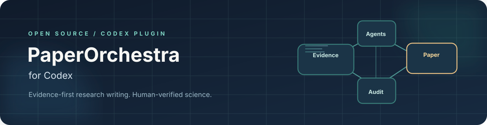
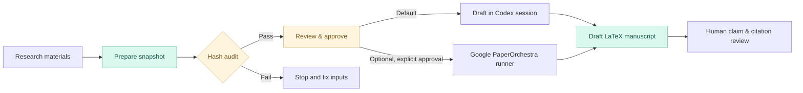

<div align="center">



### From experiment logs to reviewable papers, without losing the evidence.

A community-built **Codex plugin** for evidence-first research writing. Prepare a traceable research snapshot, run integrity checks, and draft manuscripts with the model in your active Codex session. Google's original PaperOrchestra multi-agent runner remains an optional, separate integration.

[](https://github.com/Harmain11/paper-orchestra-codex/actions/workflows/ci.yml)
[](https://python.org/)
[](LICENSE)
[](CHANGELOG.md)
[](https://github.com/google-research/paper-orchestra)

**[Install](#install-the-plugin) · [Choose a workflow](#choose-your-workflow) · [Command reference](#command-reference) · [Interactive guide](#interactive-setup-guide) · [Science & safety](#evidence-first-by-design) · [FAQ](#faq)**

</div>

> [!IMPORTANT]
> This is an **independent community integration**, not an official Google, Google Research, OpenAI, or Codex product. The plugin does **not** automatically verify scientific claims, create new GPU results, or guarantee publication. The default writing workflow uses the active Codex session and does not require a separate provider API key. Google's original PaperOrchestra runner is a separate, optional installation and may incur API charges.

## Why this exists

Writing a paper is easier than validating one. This plugin keeps **source evidence and source-derived claims** ahead of manuscript generation, and makes the costly actions deliberate.

| 🧬 Evidence first | 🔎 Checkable by default | ✍️ Draft with Codex |
|:--|:--|:--|
| Snapshot source logs, protocols and approved figures | Verify file integrity with SHA-256 and refuse altered bundles | Draft outlines and LaTeX in the active Codex session |
| Never turn example data into research findings | Separate hashes from scientific and citation verification | Optional upstream Google runner remains separate and requires explicit approval |



## Install the plugin

**Codex desktop app (no terminal required):**

1. Open **Customize → Plugins**.
2. If the marketplace is not listed, use **Add** to add `https://github.com/Harmain11/paper-orchestra-codex`.
3. Under **Personal**, open **Research Workflow Plugins**, select **PaperOrchestra for Codex**, then install it.
4. Start a new Codex task and ask it to audit or draft from your research files. Codex-native drafting does not require a separate provider API key.

To refresh a GitHub marketplace after an update, use the refresh control in the Plugins screen. Adding a marketplace does not automatically install or enable every plugin. [Codex plugin documentation](https://developers.openai.com/plugins/build/plugins).

<details>
<summary><b>Codex CLI installation</b></summary>

If you use the Codex CLI, add the public marketplace from a terminal:

```bash
codex plugin marketplace add Harmain11/paper-orchestra-codex
```

</details>

<details>
<summary><b>Option B — Local CLI marketplace</b></summary>

Clone the repository or extract the source ZIP, keeping hidden folders such as `.agents` and `.codex-plugin`. From its root, use the Codex CLI:

```bash
codex plugin marketplace add .
```

Install the plugin from the local marketplace UI. If your Codex build doesn't provide the marketplace command, use the [standalone CLI](#command-reference) while checking the official current installation docs.

</details>

<details>
<summary><b>What does Codex actually install?</b></summary>

It discovers the marketplace manifest at `.agents/plugins/marketplace.json`, which points to the packaged plugin. The plugin contains three reusable skills and a local Python bridge. Drafting uses the active Codex session by default and does not need a separate API key. Python is needed only for local snapshot and hash-audit helpers; the Google Research repository, Python packages and provider credentials for its optional runner are **not bundled or automatically installed**.

</details>

## Choose your workflow

<details open>
<summary><b>01 · I want to audit research before writing a paper</b> — free, offline</summary>

Start with a folder containing `idea_sparse.md`, `experimental_log.md` and optional verified figures. Use the same Python bridge from your local clone of this repository:

```bash
python plugins/paper-orchestra-codex/scripts/po_bridge.py prepare --materials examples/demo/raw_materials --bundle work/demo
python plugins/paper-orchestra-codex/scripts/po_bridge.py audit --bundle work/demo
```

The bundled demo uses **fictional materials only**. Replace it with real experiment records for genuine research work. The audit checks hashes and file inventory, **not** whether a statistical claim is true.

</details>

<details>
<summary><b>02 · I want local evidence checks</b> — Python optional for writing

Python is required only to create the reproducible evidence bundle and verify its SHA-256 manifest. If `python` is unavailable, Codex can still inspect files and draft, but must label the hash audit as not run.

</details>

<details>
<summary><b>03 · I want to set up Google's upstream PaperOrchestra</b> — network action requires approval</summary>

```bash
python plugins/paper-orchestra-codex/scripts/po_bridge.py doctor
python plugins/paper-orchestra-codex/scripts/po_bridge.py setup --destination ../paper-orchestra
# Review upstream code and the clone plan, then explicitly approve:
python plugins/paper-orchestra-codex/scripts/po_bridge.py setup --destination ../paper-orchestra --execute
```

Create a **Python 3.11+** virtual environment inside the upstream project, install its `requirements.txt`, and configure your own `.env` there. Set provider-level API spending limits. See [setup walkthrough](#upstream-environment).

</details>

<details>
<summary><b>04 · I want a complete LaTeX draft using Codex</b> — no separate provider API key

After auditing the evidence, ask the plugin to draft a LaTeX manuscript in the active Codex session. You do not need to install Google's runner, configure a Gemini/OpenAI API key, or run a separate model command. Review all claims and references before using the draft.

If you specifically want Google's original multi-agent runner, choose the optional path below. It requires its own checkout and provider credentials, and may incur charges.

</details>

<details>
<summary><b>05 · I specifically want Google's multi-agent runner</b> — separate provider usage possible</summary>

First create and audit a bundle containing **real evidence** and install upstream PaperOrchestra. Then preview the invocation:

```bash
python plugins/paper-orchestra-codex/scripts/po_bridge.py run --upstream ../paper-orchestra --bundle work/my-study --output-dir work/manuscript --template-dir templates/cvpr2025
```

Nothing runs until you repeat the reviewed command with `--execute`. PaperOrchestra may transmit research materials to your selected model provider. Review the LaTeX output and every quantitative statement manually.

</details>

<details>
<summary><b>06 · I'm building my own research agent</b> — use the bridge as a component</summary>

The bridge is Python standard-library only; `doctor`, `prepare`, `audit`, `setup`, and `run` are callable from a terminal or agent. Keep the original upstream PaperOrchestra dependency outside this repo. Read [research integrity rules](plugins/paper-orchestra-codex/references/RESEARCH_INTEGRITY.md), [contributing](CONTRIBUTING.md), and the [test suite](tests/test_bridge.py).

</details>

## Interactive setup guide

**Want commands tailored to your operating system and model provider?** Use the **[interactive setup wizard](https://harmain11.github.io/paper-orchestra-codex/)** after GitHub Pages is enabled, or clone the repository and open [`docs/index.html`](docs/index.html) locally in your browser. It creates copyable commands without contacting model APIs or uploading data.

> GitHub README files support collapsible sections, links and Mermaid diagrams, but not custom JavaScript. The setup wizard lives in `docs/index.html` because a genuinely interactive interface needs a web page.

## Command reference

Run all examples from this repo's root. The bridge requires Python 3.11+ but only Python's standard library.

| Command | What it does | Network/API calls |
|---|---|---|
| `doctor` | Check Python, Git, LaTeX and credential *presence* | None |
| `setup --destination PATH` | Preview cloning upstream | None |
| `setup --destination PATH --execute` | Clone original PaperOrchestra | **GitHub network** |
| `prepare --materials DIR --bundle DIR` | Create a source snapshot and hash manifest | None |
| `audit --bundle DIR` | Detect missing, modified or untracked files | None |
| `run --upstream DIR --bundle DIR --output-dir DIR` | Preview Python generation command | None |
| `run ... --execute` | Start upstream manuscript-generation pipeline | **External model APIs possible** |

<details>
<summary><b>Show full input structure and real-run command</b></summary>

```text
raw_materials/
├── idea_sparse.md          # Question, motivation and testable hypothesis
├── experimental_log.md     # Provenance, methods, measured numbers, limitations
└── figures/
    ├── figure_01.png       # Verified figure, not a fabricated illustration
    └── figure_02.pdf
```

```bash
python plugins/paper-orchestra-codex/scripts/po_bridge.py prepare --materials ./my-study/raw_materials --bundle ./work/my-study
python plugins/paper-orchestra-codex/scripts/po_bridge.py audit --bundle ./work/my-study
python plugins/paper-orchestra-codex/scripts/po_bridge.py run --upstream ../paper-orchestra --bundle ./work/my-study --output-dir ./work/my-paper --template-dir templates/cvpr2025
# Add --execute to the same run command ONLY after reviewing inputs, costs and provider privacy.
```

</details>

### Upstream environment

<details>
<summary><b>Windows PowerShell</b></summary>

```powershell
cd ../paper-orchestra
py -3.11 -m venv .venv
.\.venv\Scripts\Activate.ps1
python -m pip install -r requirements.txt
```

</details>

<details>
<summary><b>macOS / Linux</b></summary>

```bash
cd ../paper-orchestra
python3.11 -m venv .venv
source .venv/bin/activate
python -m pip install -r requirements.txt
```

</details>

Upstream credentials belong in a **local** `paper-orchestra/.env`, never in GitHub. Its CLI currently defaults to Gemini preview models and supports model-provider configuration; confirm provider compatibility and prices at runtime. Optional TeX tools are needed for PDF compilation. [Upstream README](https://github.com/google-research/paper-orchestra#readme).

## Evidence-first by design

| Safety property | Implemented behavior | Still requires human review |
|---|---|---|
| File provenance | SHA-256 hashes and sizes for source snapshots | Whether files were collected correctly |
| Integrity gates | Fail on altered, missing, added or symlinked files | Whether claims are supported by those files |
| Secrets | Ignore common `.env`, key and credential filenames | Detect secrets hidden in other file types |
| Cost control | No clone / API call without `--execute` | Provider pricing and token spending |
| Claims | Clear evidence-review instructions in skills | Citations, statistical tests and correctness |

Read [security](SECURITY.md) before sending unpublished or confidential material to model providers. This plugin cannot guarantee journal acceptance, originality, or peer review.

## Repository map

```text
.agents/plugins/marketplace.json            Marketplace catalog
plugins/paper-orchestra-codex/plugin.json  Portable plugin metadata
plugins/paper-orchestra-codex/.codex-plugin/plugin.json   Codex compatibility
plugins/paper-orchestra-codex/skills/       Setup / Audit / Write skills
plugins/paper-orchestra-codex/scripts/po_bridge.py  Safe Python bridge
docs/index.html                              Interactive setup wizard
assets/hero.svg                             README artwork
tests/test_bridge.py                        Offline regression tests
.github/workflows/ci.yml                   Ubuntu and Windows CI
```

## FAQ

<details>
<summary><b>Do I need a separate API key if I already use Codex?</b></summary>

No. The default workflow drafts with the model in your active Codex session and does not need a separate Gemini, Vertex, or OpenAI API key. The optional Google PaperOrchestra runner is a separate program and needs its own provider credentials; it can incur API charges. Python is only needed for the plugin's local evidence snapshot and hash-audit helpers.

</details>

<details>
<summary><b>Is this the official Google PaperOrchestra project?</b></summary>

No. This is a separate community wrapper, with attribution and license notices. [Original Google repository](https://github.com/google-research/paper-orchestra).

</details>

<details>
<summary><b>Can it write a publishable paper automatically?</b></summary>

It can invoke a workflow intended to produce submission-ready LaTeX, but **scientific validity, references, formatting and suitability require independent checks**. Do not treat model-generated text as validated scientific evidence.

</details>

<details>
<summary><b>Does installing this plugin send my research data to an API?</b></summary>

No. Installing the plugin and running local hashing do not send research files to an external model provider. When you draft in Codex, follow the data controls for your Codex account. `run --execute` starts Google's optional upstream pipeline, which may send provided research materials to configured model providers.

</details>

<details>
<summary><b>Can I use it without Codex?</b></summary>

Yes. The bridge CLI can be run directly from Python, and the optional website is a standalone static page.

</details>

<details>
<summary><b>Why doesn't the repository include a sample scientific paper?</b></summary>

The demo input intentionally contains no fabricated results. Use your own validated evidence and reproduce experiments before publishing claims.

</details>

## Publish your own repository (maintainer)

The maintainer can publish this source with the **dry-run-first helper** after reviewing the public file list. It requires local Git and the authenticated [GitHub CLI](https://cli.github.com/):

```bash
python scripts/publish_to_github.py                 # preview: changes nothing
python scripts/publish_to_github.py --execute       # creates a PUBLIC repo and pushes
```

It targets **Harmain11/paper-orchestra-codex** and refuses to overwrite an existing repo. Set **Settings → Pages → GitHub Actions** after publishing to activate the interactive docs site. The same steps are provided in [the ready-to-paste Codex handoff prompt](CODEX_SETUP_PROMPT.md).

## Release checklist

Publishing under `Harmain11`? Follow the [release checklist](RELEASE_CHECKLIST.md), including GitHub Pages enablement and a verified manual Codex install. This community package is not yet an official-directory listing.

## Contributing

Issues, pull requests and reproducibility improvements are welcome. Please read [CONTRIBUTING.md](CONTRIBUTING.md) and [SECURITY.md](SECURITY.md). Run the offline tests before opening a PR:

```bash
python -m unittest discover -s tests -v
python -m compileall -q plugins/paper-orchestra-codex/scripts
```

CI runs on Ubuntu and Windows. The `docs/` static site can be published with the included GitHub Pages workflow after enabling **Settings → Pages → GitHub Actions**. A manual Codex installation and a real upstream manuscript smoke test still need to be verified separately. [Third-party notices](THIRD_PARTY_NOTICES.md) · [Changelog](CHANGELOG.md) · [MIT License](LICENSE).

---

<div align="center">

**Build from evidence. Keep the audit trail. Let the writing agents help—not decide the science.**

Made with care by [Harmain Dastgir](https://github.com/Harmain11) · Independent community integration.

</div>
